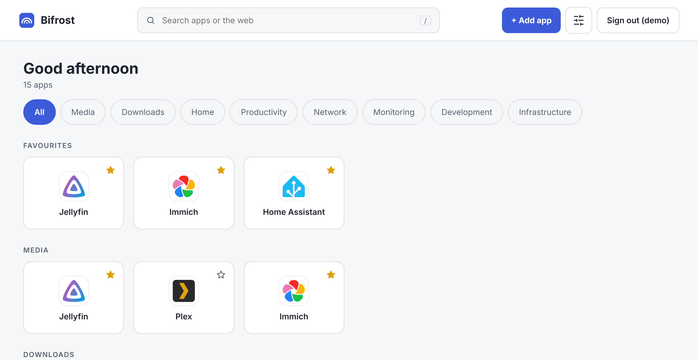
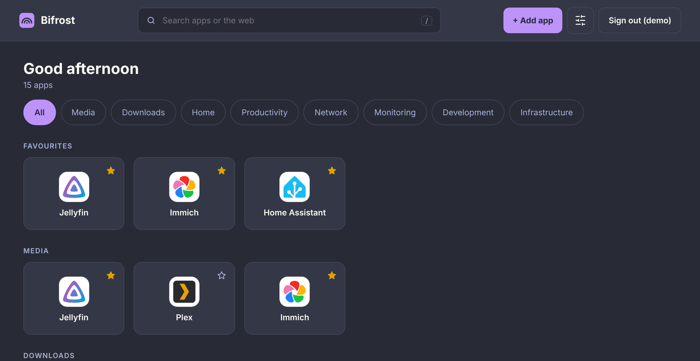

<p align="center">
  
</p>

<h1 align="center">Bifrost</h1>

<p align="center">
  A small, fast, self-hosted start page for your apps and services.<br>
  One lightweight page that links to everything you run.
</p>

<p align="center">
  <a href="https://github.com/dbohry/bifrost/actions/workflows/ci.yml"></a>
  <a href="https://github.com/dbohry/bifrost/actions/workflows/release.yml"></a>
  <a href="https://hub.docker.com/r/dbohry/bifrost"></a>
  <a href="https://hub.docker.com/r/dbohry/bifrost"></a>
</p>

<p align="center">
  
  
</p>

## Features

- **About 580 apps ready to add**, with their logos: Jellyfin, Sonarr, Home Assistant, Immich, Nextcloud and many more. Or add any address yourself.
- **Private dashboards.** Every user has their own apps, favourites and look.
- **Themes.** Light, dark or follow the device. Bifrost, Dracula, Nord, Gruvbox and Solarized are built in.
- **Works on phones, tablets and desktops**, in either orientation.
- **Search** your apps as you type, or fall back to a web search.
- **Backup.** Export your apps and look to a file and import them anywhere.
- **Status checks.** Switch it on for an app and its icon gets a badge: green when it answers, red with a cross when it does not.
- **Tiny.** One Go binary and one SQLite file. No other services.

## Run it

You need [Docker](https://docs.docker.com/get-docker/). The image runs on PCs, servers and Raspberry Pi (amd64 and arm64).

```sh
docker run -d --name bifrost --restart unless-stopped \
  -p 8080:8080 -v bifrost-data:/data \
  dbohry/bifrost:latest
```

Or with Docker Compose, using the [`docker-compose.yml`](docker-compose.yml) in this repository:

```sh
docker compose up -d
```

Then open <http://localhost:8080>. The first visit asks you to create the administrator account. **Whoever opens the page first creates it**, so do this before you share the address.

Everything Bifrost stores lives in the `/data` volume.

> `latest` is rebuilt from `main` on every merge. To build the image yourself, run `docker build -t bifrost .` and use `bifrost` instead of `dbohry/bifrost:latest` above.

### Settings

Both are optional.

| Variable | Default | Meaning |
|---|---|---|
| `BIFROST_ADDR` | `:8080` | Address the server listens on |
| `BIFROST_DATA_DIR` | `/data` | Where the database is kept |

### Update

```sh
docker pull dbohry/bifrost:latest
docker stop bifrost && docker rm bifrost
# then run it again with the same command as above
```

Your data stays in the volume, and the database upgrades itself when Bifrost starts. With Compose: `docker compose pull && docker compose up -d`.

### Back up

- **Your own dashboard:** Settings → Backup → Download export.
- **The whole server**, with every user: stop the container and copy the `/data` volume.

### Locked out?

There is no password reset on the sign-in page. Reset it from the machine that runs Bifrost:

```sh
docker exec bifrost /bifrost reset-password <username>
```

It prints a temporary password and signs that user out everywhere. They choose a new one at their next sign-in.

### HTTPS and reverse proxies

Plain HTTP is fine on a home network. Behind a reverse proxy that serves HTTPS, have it send `X-Forwarded-Proto: https` and Bifrost marks its cookie as secure. Every request then appears to come from the proxy, so the sign-in rate limit is shared between all users.

## Using it

- **Add an app.** Press **Add app**. Pick one from the list, enter the address you open it at, and save. Or choose **Custom app**.
- **Two layouts.** The buttons above the apps switch between **By category** and **All apps**, a single list in the order you left it. The tiles glide to their new places. Drag works in both: in the list you can move an app anywhere. The choice is remembered on that device.
- **Reorder.** Drag a tile. Drop it in another category to move the app there. On a touch screen, press and hold first.
- **Favourites.** Star an app to also show it in a row at the top.
- **Search.** Press `/` to jump to the search box. Enter opens the best match, or searches DuckDuckGo if nothing matches.
- **Touch screens.** The edit buttons are hidden until you press **Edit**. On a phone held upright, the main buttons are in a bar at the bottom.
- **Users.** The first account is the administrator and can add and remove users in Settings → Users. A new user gets a temporary password, shown once, and must choose their own.
- **Status checks.** In an app's details, switch on **Check if this app is online**. Bifrost (the server, not your browser) asks the app for a reply every minute and puts a badge on its icon: green for online, grey while it makes up its mind, and red with a cross and "Offline · 3 min" when it has failed twice in a row. Hover the badge (or focus the tile with the keyboard) for a card with the details: since when, why, what was checked, and a bar for each of the last 24 hours. A bar is green when every check that hour passed, and fills red from the bottom in proportion to the checks that failed. Hours before the check was switched on are empty. When something is offline, an **Offline · N** button above the apps shows only those. A test button in the form tries the settings right away.
  - The **address to check** is optional. Leave it empty to use the app's address. Fill it in when the server can reach the app at a different address than you do, for example `192.168.1.20:8000`. In Docker, `localhost` means the Bifrost container itself.
  - **Counts as online when**: by default any answer does, even a login page. Choose success to count only HTTP 200 to 299. A self-signed certificate can be trusted per app.
  - Settings → Status checks sets how often (1, 2 or 5 minutes, or your own number of seconds from 10 to 86400) and how long to wait (1, 5, 10, 30 seconds or your own, up to 60).
  - Checks start off. Apps added from the built-in list also start off; this is one setting in the code if you would rather they start on.
  - The latest result is kept in memory, so a restart looks again straight away. The counts behind the 24-hour bar (checks made and failed per hour) are saved to the database every five minutes and when Bifrost stops, and kept for a week. Checks send a plain GET request with no cookies or login, and follow at most two redirects.
- **Look.** Settings → Appearance sets the mode, a theme for light and one for dark, and the logo. It follows you to every device.
- **Keyboard only.** Everything works with the arrow keys. Press `/` to reach the search box (or Tab once), then the arrows move to the nearest control in that direction: tiles, category tabs, the layout switch, buttons, dialog fields and settings. Enter opens an app in a new tab. With a tile focused, `E` opens its details, `F` stars it, and **Alt + arrows** move it: left and right one place, up and down one row, and past the first or last row into the neighbouring category. Esc closes a dialog, or leaves Settings.

## More

- [Development](docs/DEVELOPMENT.md): build, test and project layout.
- [Design notes](docs/DESIGN.md): goals, architecture, scope and what comes next.
- [Wireframes](docs/wireframes/README.md): the screens as they were designed, including the proposed status checks.
- Icons come from [dashboard-icons](https://github.com/homarr-labs/dashboard-icons) (Apache-2.0) and belong to their projects. See [`NOTICE.md`](internal/catalog/icons/NOTICE.md).
